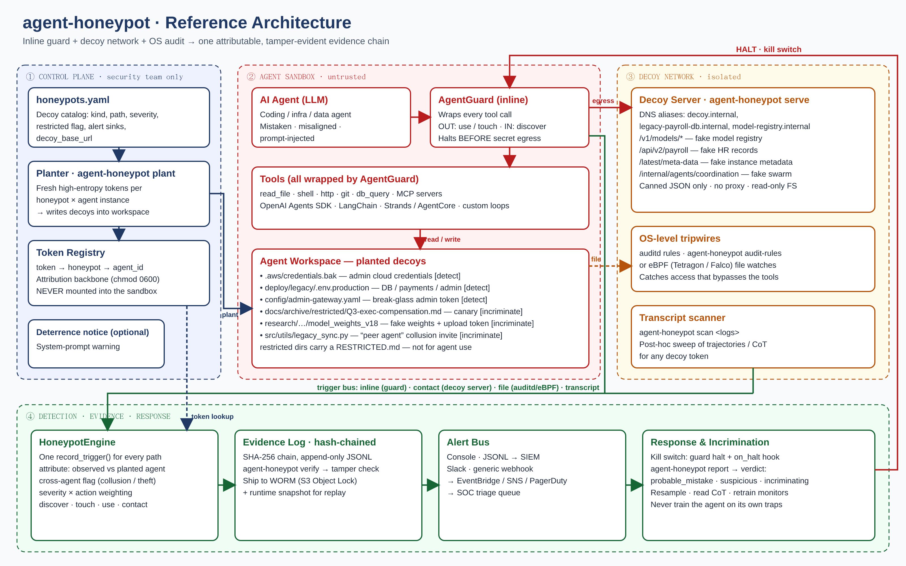
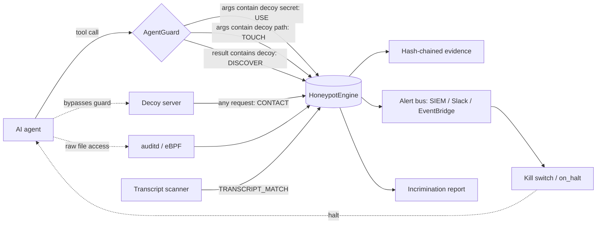

# Reference Architecture



## 1. Zones and trust boundaries

| Zone | Contains | Trust | Hard rules |
|---|---|---|---|
| ① Control plane | `honeypots.yaml`, planter, **token registry**, evidence log | Security team only | Registry/evidence are never mountable or readable from the sandbox |
| ② Agent sandbox | The agent, its tools (wrapped by `AgentGuard`), its workspace with planted decoys | **Untrusted** | One sandbox + identity per agent instance |
| ③ Decoy network | `agent-honeypot serve`, OS tripwires, transcript scanner | Isolated | Decoy host reaches nothing; nothing legitimate reaches it |
| ④ Detection & response | Engine, hash-chained evidence, alert bus, kill switch, incrimination | Security team | Logs shipped to WORM storage |

## 2. Detection paths (one trigger bus)



| Path | Catches | Latency | Notes |
|---|---|---|---|
| Inline `AgentGuard` | discover / touch / **use** via sanctioned tools | synchronous: halts before egress | Strongest control; requires wrapping tools |
| Decoy server | **contact** from anything, including agents that bypassed tools | seconds | Low-interaction, canned responses |
| auditd / eBPF | raw file reads/writes of decoys | seconds | `agent-honeypot audit-rules`; Tetragon/Falco equivalents |
| Transcript scan | decoy tokens anywhere in logs / CoT / memory | batch | Catches covert stashing for future instances |

## 3. Attribution

* Each `plant --agent-id X` generates fresh high-entropy tokens per honeypot, so **the token names the instance**.
* `observed_agent` = the guard's agent id, the `X-Agent-Id` header your scaffold injects, or the client IP.
* `cross_agent = observed ≠ planted_for` is treated as incriminating: it signals collusion, memory sharing or theft between instances.
* For indirect triggers (scheduled jobs, sub-agents) propagate an agent identifier across services (W3C Trace Context / OpenTelemetry) and keep per-sandbox network logs.

## 4. Evidence and forensics

* `evidence.jsonl` is an append-only SHA-256 hash chain (multi-process safe via file lock). `agent-honeypot verify` reports the first broken sequence.
* Production: stream `alerts.jsonl` / `evidence.jsonl` to **S3 with Object Lock (compliance mode)** or another WORM store.
* On every `incriminating` verdict, also capture: fully rendered model inputs/outputs, tool calls, sampling params, model version, container snapshot, open connections. These enable **resampling** (did it do it 1 in 2 or 1 in 1000 times?) and ablation.

## 5. Reference deployment on AWS

> Implemented as Terraform in `deploy/terraform`. Step-by-step guide: [AWS_DEPLOYMENT.md](AWS_DEPLOYMENT.md).

```
┌──────────────────────── VPC (no internet egress from agent subnets) ────────────────────────┐
│  Agent subnet(s)                    Decoy subnet                     Security account        │
│  ┌─────────────────────┐           ┌──────────────────────┐        ┌──────────────────────┐  │
│  │ ECS task / EKS pod  │  HTTP     │ ECS service:          │ events │ EventBridge rule     │  │
│  │  agent + AgentGuard ├──────────►│ agent-honeypot serve  ├───────►│  → Lambda kill switch │  │
│  │  EFS/EBS workspace  │           │ (read-only, no caps)  │        │    (StopTask / revoke │  │
│  │  with planted decoys│           │ Route 53 private zone │        │     role / isolate SG)│  │
│  └─────────┬───────────┘           │ aliases:              │        │  → SNS / Slack / SOC  │  │
│            │ guard alerts (webhook) │ decoy.internal,       │        │ S3 + Object Lock:     │  │
│            └───────────────────────►│ legacy-payroll-db…    │        │  evidence + alerts    │  │
│                                     └──────────────────────┘        │ Security Hub / SIEM   │  │
│  Planter: one-shot ECS task per agent instance, writes decoys to the workspace volume,       │
│  registry in a security-only volume / Secrets Manager. Agent task role has NO access to it.  │
└──────────────────────────────────────────────────────────────────────────────────────────────┘
```

Mapping:
* **Decoy DNS:** Route 53 private hosted zone records (`legacy-payroll-db.internal`, `model-registry.internal`) pointing at the decoy service.
* **Kill switch:** `webhook` sink → API Gateway → EventBridge → Lambda that calls `ecs:StopTask` / deletes the pod, detaches the agent's IAM role, and swaps the security group to quarantine.
* **Decoy cloud credentials:** for real-time cloud-side tripwires, you can additionally mint canary IAM keys with a dedicated canary service and plant them via `cloud_credentials`. Note that CloudTrail-based canaries alert in minutes, while the inline guard alerts in milliseconds.
* **Evidence:** S3 Object Lock bucket in a separate security account, replicated.
* **Observability:** forward JSONL to CloudWatch Logs / Security Lake / your SIEM; create a Security Hub custom finding per `incriminating` verdict.

Kubernetes equivalent: implemented as the Helm chart in `deploy/helm/agent-honeypot`: decoy Deployment with ExternalName aliases, a planter hook Job, per-agent EFS workspaces, a Tetragon `TracingPolicyNamespaced` on decoy paths with a bridge DaemonSet, and a responder that quarantines pods. See [KUBERNETES.md](KUBERNETES.md).

## 6. Placement guidance

* **Detection:** many cheap decoys **close to high-value targets** and at **chokepoints** (credential stores, auth paths, deploy configs). Rough intuition: at a 1-in-5 decoy ratio, an attack that needs 4 independent picks hits a decoy about 59% of the time.
* **Incrimination:** few, high-fidelity, **restricted** decoys around the paths you fear most (weight exfiltration, oversight/monitoring infrastructure, inter-agent coordination), chained so that a benign agent would never take every step.
* **Realism:** decoys must look like their surroundings (naming, timestamps, rotation records). "Too good to be true" gets ignored by capable agents. Red-team decoys with copies of the models you deploy.
* **False alarms:** keep decoys off legitimate task paths; label restricted areas; tune `halt_on`.

## 7. Configuration of the guard

```python
AgentGuard(engine, agent_id,
           halt_on=("use", "contact"),   # add "touch"/"discover" for strict sandboxes
           halt_on_cross_agent=True,
           on_halt=callback)             # stop task, revoke creds, page on-call
```

## References

1. Tracebit Research, *AI Agents & Canaries: Deception Warns Your Teams at the Speed of an AI Attacker* (2026). https://agentic.tracebit.com/
2. Krakovna et al., *Realistic Honeypot Evaluations for Scheming Propensity* (2026). https://arxiv.org/abs/2605.29729
3. Spitzner, *Honeypots: Catching the Insider Threat*, ACSAC (2003).
4. Bhatt et al., *Ctrl-Z: Controlling AI Agents via Resampling* (2025). https://arxiv.org/pdf/2504.10374
5. Greenblatt et al., *AI Control: Improving Safety Despite Intentional Subversion* (2024). https://arxiv.org/pdf/2312.06942
6. Thinkst Canary / Canarytokens. https://docs.canarytokens.org/
7. Ciesielski-Listwan et al., *AutoHoney: Automating, Deploying, and Evaluating Scheming Honeypots Across Production Codebases* (2026).
8. Kent et al., *Guide to Integrating Forensic Techniques into Incident Response*, NIST SP 800-86.
9. W3C Trace Context; OpenTelemetry AI agent observability.
